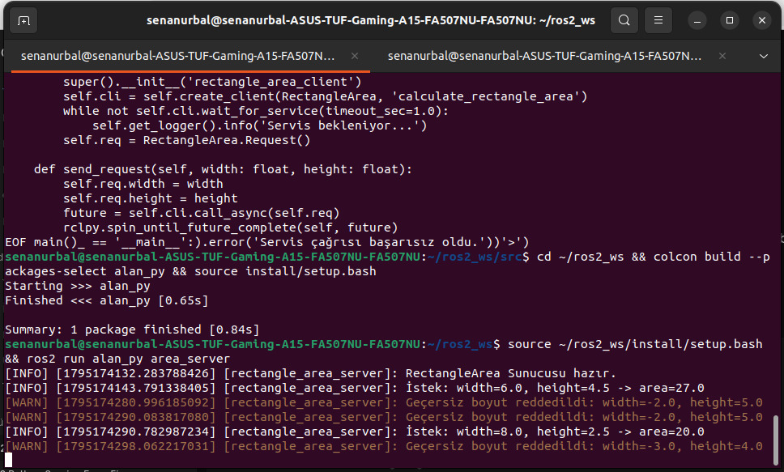
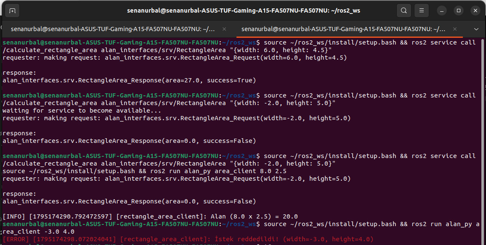

# RectangleArea Servisi (ROS 2)

Dikdörtgenin alanını hesaplayan bir ROS 2 servis uygulaması. İki paketten oluşur:

| Paket | Açıklama |
|---|---|
| `alan_interfaces` | `RectangleArea.srv` servis arayüzünü içerir |
| `alan_py` | Servis sunucusu (`area_server`) ve istemci (`area_client`) düğümleri (Python) |

## Servis Tanımı

`alan_interfaces/srv/RectangleArea.srv`

```
float64 width
float64 height
---
float64 area
bool success
```

- **İstek:** `width`, `height`
- **Yanıt:** `area` = `width × height`
- **Bonus:** `success` alanı eklendi. `width` veya `height` negatif (geçersiz) ise istek reddedilir: `success=False`, `area=0.0`.

Servis adı: `/calculate_rectangle_area`

## Kurulum ve Derleme

```bash
cd ~/ros2_ws
colcon build --packages-select alan_interfaces alan_py
source install/setup.bash
```

> Her yeni terminalde `source ~/ros2_ws/install/setup.bash` çalıştırılmalıdır.

## Çalıştırma

### 1. Sunucu (Terminal 1)

```bash
source ~/ros2_ws/install/setup.bash && ros2 run alan_py area_server
```

### 2. İstemci (Terminal 2)

İki sayı (width, height) komut satırından verilir:

```bash
source ~/ros2_ws/install/setup.bash && ros2 run alan_py area_client 8.0 2.5
```

Çıktı:

```
[INFO] [rectangle_area_client]: Alan (8.0 x 2.5) = 20.0
```

Negatif değer verilirse istek reddedilir (bonus):

```bash
source ~/ros2_ws/install/setup.bash && ros2 run alan_py area_client -3.0 4.0
```

```
[ERROR] [rectangle_area_client]: İstek reddedildi! (width=-3.0, height=4.0)
```

## Doğrulama: `ros2 service call`

Geçerli istek:

```bash
ros2 service call /calculate_rectangle_area alan_interfaces/srv/RectangleArea "{width: 6.0, height: 4.5}"
```

```
requester: making request: alan_interfaces.srv.RectangleArea_Request(width=6.0, height=4.5)

response:
alan_interfaces.srv.RectangleArea_Response(area=27.0, success=True)
```

Geçersiz (negatif) istek:

```bash
ros2 service call /calculate_rectangle_area alan_interfaces/srv/RectangleArea "{width: -2.0, height: 5.0}"
```

```
requester: making request: alan_interfaces.srv.RectangleArea_Request(width=-2.0, height=5.0)

response:
alan_interfaces.srv.RectangleArea_Response(area=0.0, success=False)
```

## Terminal Ekran Görüntüleri

### Ekran 1: Sunucu terminali



Sunucu başlatıldığında `RectangleArea Sunucusu hazır.` mesajı görülür. Sunucu gelen istekleri loglar:

- `width=6.0, height=4.5` isteği için `area=27.0` hesaplanır (`INFO`).
- `width=8.0, height=2.5` isteği için `area=20.0` hesaplanır (`INFO`).
- `width=-2.0, height=5.0` ve `width=-3.0, height=4.0` gibi negatif değerli istekler `WARN` seviyesinde "Geçersiz boyut reddedildi" mesajıyla geri çevrilir (**bonus**).

### Ekran 2: İstemci ve `ros2 service call` terminali



- `ros2 service call` ile `{width: 6.0, height: 4.5}` gönderildiğinde yanıt `area=27.0, success=True` olur.
- `{width: -2.0, height: 5.0}` gönderildiğinde yanıt `area=0.0, success=False` olur; yani negatif değer reddedilir (**bonus**).
- `area_client 8.0 2.5` komutu `Alan (8.0 x 2.5) = 20.0` çıktısını verir.
- `area_client -3.0 4.0` komutu `ERROR` seviyesinde "İstek reddedildi!" mesajı verir (**bonus**).

## Bonus Özeti

Yanıta `bool success` eklendi. Negatif `width` veya `height` değerleri sunucu tarafında reddedilir; sunucu `WARN` loglar, yanıt olarak `success=False` ve `area=0.0` döner, istemci de bunu `ERROR` olarak gösterir.

## Proje Yapısı

```
servis_odev/
├── alan_interfaces/
│   ├── srv/RectangleArea.srv
│   ├── CMakeLists.txt
│   └── package.xml
├── alan_py/
│   ├── alan_py/
│   │   ├── area_server.py
│   │   └── area_client.py
│   ├── setup.py
│   └── package.xml
├── images/
│   ├── server.jpeg
│   └── client.jpeg
├── .gitignore
└── README.md
```

